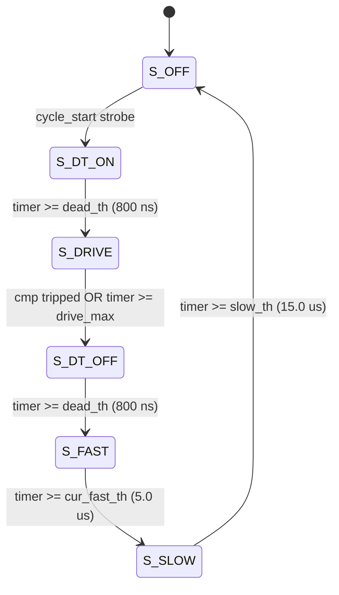

# AG32 1-Axis Bipolar Stepper Motor Driver

[](https://platformio.org/)
[](http://www.alta-gate.com/)
[]()
[](https://www.infineon.com/)
[](https://github.com/Tien550/AG32_step_driver/actions/workflows/ci.yml)
[-success.svg)](docs/LAB_TESTCASES_AND_RESULTS.md)
[](docs/VERIFICATION.md)
[](LICENSE)

An open-source, industrial-grade 1-axis bipolar stepper motor driver implemented on the **AGM AG32VF303** System-on-Chip (integrating a 100 MHz 32-bit RISC-V RV32IMAFC microcontroller and an embedded ~2K LUT FPGA/CPLD fabric).

---

## Overview

Traditional microcontroller-based stepper drivers suffer from jitter, step loss, and CPU overloading at high pulse rates. Dedicated driver ICs offer hardware execution but operate as rigid "black boxes" with fixed chopper profiles and fixed decay timings.

This project combines the best of both worlds:
- **100% Hardware-Accelerated Execution:** The entire current-chopper FSM, sine/cosine microstepping lookup tables, dead-time generators, and overcurrent latches execute in dedicated FPGA logic at **100 MHz clock rate (10 ns resolution)**.
- **Mixed-Decay Current Chopping:** Combines active **Fast Decay** ($5.0\text{ }\mu\text{s}$ reverse voltage quench) and **Slow Decay** ($15.0\text{ }\mu\text{s}$ low-side freewheeling) to eliminate current distortion during the falling quarters of the microstepping sine wave.
- **Dynamic Firmware Reconfigurability:** Timing parameters (`dead_cycles`, `fast_cycles`, `slow_cycles`, `period_cycles`) are memory-mapped to the RISC-V core via the internal 32-bit AHB-Lite bus (`0x60000000`), allowing on-the-fly tuning directly from C firmware.
- **Hardware Circuit Design:** Built-in multi-rail power distribution (+15V Gate rail, +36V to +48V Motor rail), 4-bit R-2R DAC ladders with U7 CMOS buffers, test points (TP10 Coil A, TP11 Coil B), 7407 inverter stages, and 4 discrete IRS2111S gate drivers (U19, U20, U21, U22).
- **Sub-100 ns Hardware Safety:** Overcurrent trips bypass all software pipelines, shutting down gate drives and clamping low-side MOSFETs within **80 ns** of digital qualification.
- **Zero-Crossing Elimination:** By setting the minimum LUT code to `2` ($0.413\text{ V}$ bias) instead of `0`, the dead-band zero-crossing stall is completely eliminated, simplifying the FSM to 6 deterministic states.

---

## System Architecture

```
                          AGM AG32VF303 SoC
 +-------------------------------------------------------------------+
 |  RISC-V 32-bit CPU (100 MHz)                                      |
 |  (main.c - Dynamic chopper parameter tuning over AHB)             |
 +---------------------------------+---------------------------------+
                                   | 32-bit AHB-Lite Bus (0x60000000)
                                   v
 +-------------------------------------------------------------------+
 |                       CPLD/FPGA Logic Fabric                      |
 |                                                                   |
 |  [input_sync] <--- External Inputs (PUL, DIR, EN, RUNHOLD, MODE)  |
 |         |                                                         |
 |         +---------> [microstep_seq] (4-bit Accumulator)           |
 |                           |                                       |
 |                           v                                       |
 |                 [microstep_lut (Sin/Cos)]                         |
 |                    |                 |                            |
 |              Phase A (0 deg)   Phase B (90 deg)                   |
 |                    |                 |                            |
 |                    v                 v                            |
 |              [coil_drv A]      [coil_drv B]                       |
 |             +-------------+   +-------------+                     |
 |             |  vref_dac   |   |  vref_dac   | ===> U7 Buffer      |
 |             | hbridge_fsm |   | hbridge_fsm | ===> 7407 Inverters |
 |             +-------------+   +-------------+                     |
 |                    ^                 ^        ===> 4-bit R-2R DAC |
 |                    +--------+--------+        ===> 4x IRS2111S    |
 |                             |                      (U19,U20,      |
 |                       [chop_timer]                 (U21,U22)      |
 |                       (30 kHz Master Counter)                     |
 |                             |                                     |
 |  [oc_guard] <--- PIN_17 (Overcurrent Comparator)                  |
 |       |                                                           |
 |       +------------> Hardware Safe-State Clamp (Low-Side ON)      |
 +-------------------------------------------------------------------+
```

---

## Power Distribution & Hardware Stage

The driver board is engineered with three distinct, galvanically shared voltage rails:

| Rail | Voltage | Function | Hardware Components |
| :--- | :---: | :--- | :--- |
| **Motor Rail (Purple Lead)** | **+36V to +48V DC** | Motor Power Supply | H-Bridge Power MOSFETs, Stepper Coils, Bulk Capacitors |
| **Gate Rail (Red Lead)** | **+15V DC** | Gate Driver Supply | IRS2111S ICs (U19, U20, U21, U22), Bootstrap Diodes |
| **Ground (Blue Lead)** | **0V (GND)** | Power Ground | System common return, Star ground topology |

### Key Hardware Stages:
- **Reference DAC Stage:** 4-bit digital outputs pass through buffer IC **U7**, through discrete R-2R resistor ladders, outputting analog sine/cosine reference voltages at **`TP10` (Coil A)** and **`TP11` (Coil B)**.
- **Protection Resistor:** $10\text{ k}\Omega$ series resistor into the analog comparator inputs to isolate switching noise.
- **Gate Inverter Stage:** CPLD outputs ($a', b'$ for Coil A; $c', d'$ for Coil B) pass through **7407** open-drain NOT-gates before driving IRS2111S `IN` pins.
- **Power Stage:** 4 discrete IRS2111S half-bridge drivers with internal dead time (typ. 650 ns) driving 8 N-channel power MOSFETs with bootstrap high-side gate biasing ($V_S + 15\text{V}$).

For complete schematics and circuit calculations, see [`docs/HARDWARE_CIRCUIT.md`](docs/HARDWARE_CIRCUIT.md).

---

## Hardware Pinout (`mapping.ve`)

Pin configurations mapped for the AGM AG32VF303:

### Control & Status Pins

| Signal Name | Pin No. | Direction | Pull Config | Function |
| :--- | :---: | :---: | :---: | :--- |
| `axis_en` | **PIN_1** | Input | None | Axis Enable (HIGH = active, LOW = disabled / low-side clamped) |
| `pul_x` | **PIN_96** | Input | **PULLUP** | Step Pulse (rising edge = 1 microstep advance) |
| `dir_x` | **PIN_15** | Input | None | Direction (LOW = forward / count up, HIGH = reverse / count down) |
| `runhold_x` | **PIN_78** | Input | **PULLUP** | Current Mode (HIGH = 100% Run current, LOW = 50% Hold current) |
| `microstep_x` | **PIN_16** | Input | None | Step Mode (HIGH = 16-microstep, LOW = 8-microstep) |
| `cmp_ov_c_x` | **PIN_17** | Input | **PULLDOWN** | Overcurrent Comparator (Active HIGH, 80 ns blanked, latches off) |

### Phase A (Coil A — Sine $0^\circ$)

| Signal Name | Pin No. | Direction | Hardware Stage | Function |
| :--- | :---: | :---: | :--- | :--- |
| `cmp_x_a` | **PIN_95** | Input (PULLUP) | Comparator A Out | Peak current detect (Active LOW: LOW = current reached $V_{\text{ref\_A}}$) |
| `q1_x_a` | **PIN_92** | Output | U19 IRS2111S (via 7407) | Left half-bridge gate control input (`IN_L`) |
| `q3_x_a` | **PIN_88** | Output | U20 IRS2111S (via 7407) | Right half-bridge gate control input (`IN_R`) |
| `dac_out_x_a[3:0]` | **PIN_86, 84, 82, 80** | Output | U7 Buffer $\rightarrow$ R-2R | Current reference DAC outputs ($\rightarrow$ `TP10`) |

### Phase B (Coil B — Cosine $90^\circ$)

| Signal Name | Pin No. | Direction | Hardware Stage | Function |
| :--- | :---: | :---: | :--- | :--- |
| `cmp_x_b` | **PIN_93** | Input (PULLUP) | Comparator B Out | Peak current detect (Active LOW: LOW = current reached $V_{\text{ref\_B}}$) |
| `q1_x_b` | **PIN_91** | Output | U21 IRS2111S (via 7407) | Left half-bridge gate control input (`IN_L`) |
| `q3_x_b` | **PIN_87** | Output | U22 IRS2111S (via 7407) | Right half-bridge gate control input (`IN_R`) |
| `dac_out_x_b[3:0]` | **PIN_85, 83, 81, 79** | Output | U7 Buffer $\rightarrow$ R-2R | Current reference DAC outputs ($\rightarrow$ `TP11`) |

---

## Chopper FSM State Diagram

Each coil is independently governed by a 6-state FSM ([`rtl/pwm_b_fsm.v`](rtl/pwm_b_fsm.v)):



1. **`S_DT_ON`:** Dead-time before drive. Both half-bridge inputs forced LOW (low-side FETs ON) for 800 ns.
2. **`S_DRIVE`:** Coil energized with DC bus voltage in the direction indicated by `sign_bit`. Terminates when winding current trips the analog comparator (`cmp = 0`) or reaches `drive_max`.
3. **`S_DT_OFF`:** Dead-time before decay. Both half-bridge inputs forced LOW for 800 ns.
4. **`S_FAST`:** Fast decay phase. Reverse voltage applied across the coil for $5.0\text{ }\mu\text{s}$ opposing `decay_sign` to rapidly extinguish magnetic field energy.
5. **`S_SLOW`:** Slow decay phase. Low-side FETs turned ON for $15.0\text{ }\mu\text{s}$, allowing residual current to recirculate with minimal ripple.
6. **`S_OFF`:** Idle phase until the next master chopper cycle begins.

For mathematical derivations, decay polarity latching, and zero-crossing analysis, see [`docs/FSM_CHOPPER.md`](docs/FSM_CHOPPER.md).

---

## AHB Register Map

The CPLD chopper register file is mapped into RISC-V memory space at base address **`0x60000000`**:

| Offset | Register Name | Bits | Access | Default Value | Engineering Unit (@ 100 MHz SYSCLK) |
| :---: | :--- | :---: | :---: | :---: | :--- |
| `0x00` | `dead_cycles` | `[7:0]` | R/W | `79` | **800 ns** software dead-time margin |
| `0x04` | `fast_cycles` | `[11:0]` | R/W | `499` | **5.00 $\mu\text{s}$** active fast-decay reverse quench |
| `0x08` | `slow_cycles` | `[11:0]` | R/W | `1499` | **15.00 $\mu\text{s}$** recirculating slow-decay duration |
| `0x0C` | `period_cycles`| `[11:0]` | R/W | `3332` | **33.33 $\mu\text{s}$** period (**30.00 kHz** chopper frequency) |

### Firmware Configuration (`src/main.c`)

```c
#include "main.h"

int main(void)
{
    board_init();
    INT_SetIRQThreshold(MIN_IRQ_PRIORITY);
    INT_EnableIRQ(BUT_GPIO_IRQ, PLIC_MAX_PRIORITY);

    // Configure chopper timing registers via AHB bus
    WR(0x00, 79u);   // dead_cycles   — 800 ns dead time   (= 80 - 1)
    WR(0x04, 499u);  // fast_cycles   — 5 µs fast decay    (= 500 - 1)
    WR(0x08, 1499u); // slow_cycles   — 15 µs slow decay   (= 1500 - 1)
    WR(0x0C, 3332u); // period_cycles — 30 kHz chopper     (= 3333 - 1)

    while (1) {
        // Main supervision loop
    }
}
```

---

## Microstepping Sine/Cosine Profile

The lookup table ([`rtl/sine_lut.v`](rtl/sine_lut.v)) maps 16 discrete angles per electrical revolution. Coil B is offset by $+4$ steps ($90^\circ$ spatial quadrature):

| Step Index | Angle ($\theta$) | Sine Amplitude Code | Cosine Amplitude Code | Phase A Direction | Phase B Direction |
| :---: | :---: | :---: | :---: | :---: | :---: |
| **0** | $0.0^\circ$ | `2` ($0.41\text{ V}$) | `14` ($2.89\text{ V}$) | $+$ | $+$ |
| **1** | $22.5^\circ$ | `6` ($1.24\text{ V}$) | `12` ($2.48\text{ V}$) | $+$ | $+$ |
| **2** | $45.0^\circ$ | `10` ($2.06\text{ V}$) | `10` ($2.06\text{ V}$) | $+$ | $+$ |
| **3** | $67.5^\circ$ | `12` ($2.48\text{ V}$) | `6` ($1.24\text{ V}$) | $+$ | $+$ |
| **4** | $90.0^\circ$ | `14` ($2.89\text{ V}$) | `2` ($0.41\text{ V}$) | $+$ | $+$ |
| **5** | $112.5^\circ$ | `12` ($2.48\text{ V}$) | `6` ($1.24\text{ V}$) | $+$ | $-$ |
| **6** | $135.0^\circ$ | `10` ($2.06\text{ V}$) | `10` ($2.06\text{ V}$) | $+$ | $-$ |
| **7** | $157.5^\circ$ | `6` ($1.24\text{ V}$) | `12` ($2.48\text{ V}$) | $+$ | $-$ |
| **8** | $180.0^\circ$ | `2` ($0.41\text{ V}$) | `14` ($2.89\text{ V}$) | $+$ | $-$ |
| **9** | $202.5^\circ$ | `6` ($1.24\text{ V}$) | `12` ($2.48\text{ V}$) | $-$ | $-$ |
| **10** | $225.0^\circ$ | `10` ($2.06\text{ V}$) | `10` ($2.06\text{ V}$) | $-$ | $-$ |
| **11** | $247.5^\circ$ | `12` ($2.48\text{ V}$) | `6` ($1.24\text{ V}$) | $-$ | $-$ |
| **12** | $270.0^\circ$ | `14` ($2.89\text{ V}$) | `2` ($0.41\text{ V}$) | $-$ | $-$ |
| **13** | $292.5^\circ$ | `12` ($2.48\text{ V}$) | `6` ($1.24\text{ V}$) | $-$ | $+$ |
| **14** | $315.0^\circ$ | `10` ($2.06\text{ V}$) | `10` ($2.06\text{ V}$) | $-$ | $+$ |
| **15** | $337.5^\circ$ | `6` ($1.24\text{ V}$) | `12` ($2.48\text{ V}$) | $-$ | $+$ |

---

## Hardware Laboratory Test Results (Oscilloscope Captures H1–H12)

The driver was comprehensively characterized across 10 physical hardware test cases:

| ID | Experiment | Description & Findings | Oscilloscope Capture | Result |
| :---: | :--- | :--- | :---: | :---: |
| **TC1** | 1/8 Microstepping | 8 distinct voltage levels; current tracks reference envelope | **H1** | **PASS** |
| **TC2** | 1/16 Microstepping | 16 voltage levels; noticeably smoother sine wave, near-silent motion | **H2** | **PASS** |
| **TC3** | Run / Hold Current | Instantaneous 50% amplitude drop, **75% power reduction** | **H3** | **PASS** |
| **TC4** | Direction / Enable | Smooth motion reversal; instantaneous shutdown upon EN = 0 | — | **PASS** |
| **TC5** | Overcurrent Trip | Hardware shutoff within $< 80\text{ ns}$, permanent latching | — | **PASS** |
| **TC6** | Frequency Sweep | Swept pulse frequency up to pull-in stall cutoff at **$\approx 3.7\text{ kHz}$** | **H4, H5, H6, H7, H8** | **PASS** |
| **TC7** | Mixed-Decay Zoom | Measured $5.0\text{ }\mu\text{s}$ Fast Decay and $15.0\text{ }\mu\text{s}$ Slow Decay on winding | — | **PASS** |
| **TC8** | Chopper Frequency | Measured total switching period of $33.33\text{ }\mu\text{s}$ (**30.00 kHz**) | — | **PASS** |
| **TC9** | Dynamic Mode Switch | 16-step $\rightarrow$ 8-step switch at index 1; verified with trigger pins 51/52 | **H9', H10** | **PASS** |
| **TC10**| Phase-Shifted Mode | Measured dual-coil waveforms with interleaved $180^\circ$ phase offset | **H11, H12** | **PASS** |

For waveforms, oscilloscope screenshots, and deep-dive notes, see [`docs/LAB_TESTCASES_AND_RESULTS.md`](docs/LAB_TESTCASES_AND_RESULTS.md).

---

## Digital Simulation Verification (`rtl/tb_stepper.v`)

The Verilog testbench exercises the digital core with 12 automated test cases:

| ID | Test Scenario | Verified Behavior | Status |
| :---: | :--- | :--- | :---: |
| **TC1** | Reset Verification | All gate outputs forced LOW during reset | **PASS** |
| **TC2** | FSM Full Cycle | Sequence verification: DRIVE $\rightarrow$ FAST $\rightarrow$ SLOW | **PASS** |
| **TC3** | 16-Step Polarity | Sign inversion and reverse quench verification across 16 microsteps | **PASS** |
| **TC4** | Direction Control | Forward counting, reverse counting, and circular 15 $\leftrightarrow$ 0 wrap | **PASS** |
| **TC5** | Hold Mode Scaling | 50% DAC scaling ($\lfloor 15 / 2 \rfloor = 7$) in Hold mode | **PASS** |
| **TC6** | Enable Control | Immediate gate shutdown upon `axis_en = 0` | **PASS** |
| **TC7** | Pulse Width Timing | Verification of 500-clock FAST and 1500-clock SLOW widths | **PASS** |
| **TC8** | Overcurrent Latch | 80 ns blanked latching and permanent safe clamp | **PASS** |
| **TC9** | Hold-Mode Stepping | Pulse acceptance and position tracking during Hold mode | **PASS** |
| **TC10**| Zero-Crossing Quench | Safe transition through zero-crossing microstep | **PASS** |
| **TC11**| Phase Interleaving | Interleaved chopper start phases for reduced rail ripple | **PASS** |
| **TC12**| Immediate Startup | Instant step registration post-reset | **PASS** |

---

## Build and Flashing Guide

### Requirements
- [PlatformIO Core](https://platformio.org/) or VS Code PlatformIO IDE.
- [AgRV PlatformIO SDK Package](http://www.alta-gate.com/) for AGM AG32.
- Hardware probe: Segger J-Link or CMSIS-DAP debugger.

### Build Commands
```bash
# Build MCU firmware and CPLD bitstream
pio run -e debug

# Upload bitstream and firmware to AG32VF303
pio run -e debug -t upload
```

---

## Repository Structure

```
.
├── LICENSE                          # MIT License
├── README.md                        # English master documentation
├── mapping.ve                       # AGM CPLD pin assignment configuration
├── platformio.ini                   # PlatformIO build configuration for agrv2k_303
├── docs/                            # In-depth technical documentation suite
│   ├── ARCHITECTURE.md              # Complete hardware & RTL architecture
│   ├── HARDWARE_CIRCUIT.md          # Power rails, U7 buffer, 7407, IRS2111S, bootstrap
│   ├── FSM_CHOPPER.md               # Mixed-decay chopper theory & state machine
│   ├── LAB_TESTCASES_AND_RESULTS.md # 10 real-world lab tests & oscilloscope captures
│   ├── INDUSTRIAL_COMPARISON.md     # Benchmark vs Siruba & Brother 430D drivers
│   ├── PINOUT_AND_SCHEMATIC.md      # Detailed pinout & interface calculations
│   ├── REGISTERS_API.md             # AHB-Lite register map & C driver API
│   ├── VERIFICATION.md              # Testbench specifications & simulation report
│   └── images/                      # Oscilloscope captures, schematics, and diagrams
├── rtl/                             # Verilog digital hardware sources
│   ├── blanking_filter.v            # Generic digital noise blanking filter
│   ├── chopper_thresholds.v         # Dynamic timing limit calculator
│   ├── chopper_timer.v              # Master 30 kHz chopper counter
│   ├── coil_driver_dac.v            # Single-coil driver wrapper (DAC + FSM)
│   ├── dac4_vref.v                  # 4-bit R-2R DAC output with Run/Hold scaling
│   ├── input_sync.v                 # Multi-signal input synchronizer
│   ├── oc_latch.v                   # Overcurrent qualification & latching guard
│   ├── pwm_b_fsm.v                  # 6-state peak-current mixed-decay FSM
│   ├── pwm_gate_dec.v               # IRS2111S gate signal decoder
│   ├── pwm_timer.v                  # Chopper phase interval timer
│   ├── sine_lut.v                   # 16-entry sine/cosine microstepping LUT
│   ├── step_sequencer.v             # Microstep counter & pulse edge detector
│   ├── stepper_axis.v               # 2-phase axis core (Phase A & B)
│   ├── stepper_top.v                # Top-level with AHB bus interface
│   ├── stepper_top_sim.v            # Simulation top-level module (ax1_sim)
│   ├── syn_in_signal.v              # Multi-stage flip-flop synchronizer
│   └── tb_stepper.v                 # Comprehensive 12-testcase verification bench
└── src/                             # RISC-V MCU firmware
    ├── main.c                       # Application entry & AHB register setup
    └── main.h                       # CPLD memory-map macros & system headers
```

---

## Documentation Index

- [System Architecture (docs/ARCHITECTURE.md)](docs/ARCHITECTURE.md)
- [Hardware Circuit Design & Power Architecture (docs/HARDWARE_CIRCUIT.md)](docs/HARDWARE_CIRCUIT.md)
- [Chopper FSM & Mixed Decay Theory (docs/FSM_CHOPPER.md)](docs/FSM_CHOPPER.md)
- [Laboratory Testcases & Waveforms H1–H12 (docs/LAB_TESTCASES_AND_RESULTS.md)](docs/LAB_TESTCASES_AND_RESULTS.md)
- [Industrial Comparison: Siruba & Brother 430D (docs/INDUSTRIAL_COMPARISON.md)](docs/INDUSTRIAL_COMPARISON.md)
- [Pinout & Hardware Calculations (docs/PINOUT_AND_SCHEMATIC.md)](docs/PINOUT_AND_SCHEMATIC.md)
- [AHB Register Map & C Driver API (docs/REGISTERS_API.md)](docs/REGISTERS_API.md)
- [Digital Simulation Testbench Report (docs/VERIFICATION.md)](docs/VERIFICATION.md)

---

## Author & License

Designed and maintained by **Tien550** ([nguyentien.work2010@gmail.com](mailto:nguyentien.work2010@gmail.com)).  
Released under the [MIT License](LICENSE).
