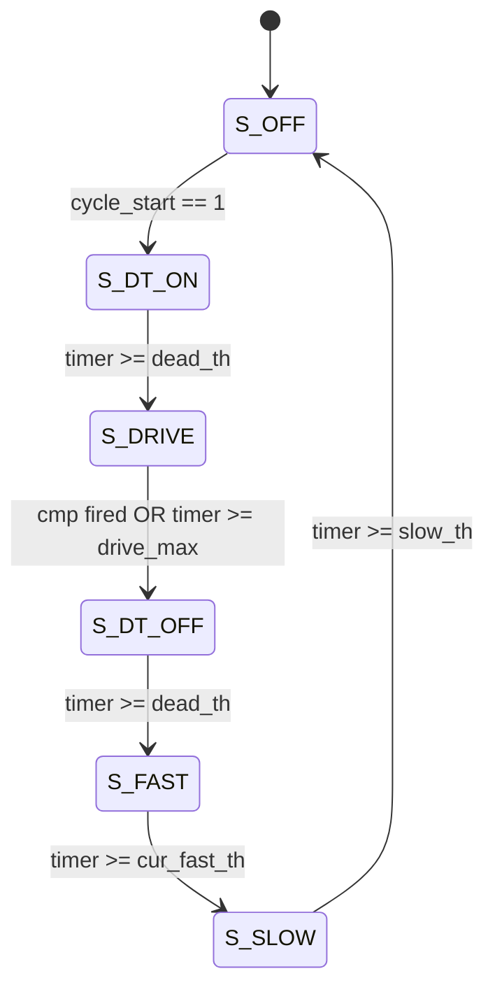

# Peak-Current Mixed-Decay Chopper FSM Specification

This document details the Peak-Current Chopper Finite State Machine (`hbridge_fsm` in `rtl/pwm_b_fsm.v`) implemented on the AG32 CPLD fabric.

---

## 1. Chopper Working Principle

Stepper motors are inductive loads ($V = L \frac{di}{dt} + R i + e_{bemf}$). To achieve high stepping speeds and microstepping accuracy without excessive resistive dissipation, a **constant-current chopper** is used:

1. **Active Drive:** The full DC bus voltage is applied across the motor coil until the winding current reaches the reference threshold set by the R-2R DAC ($V_{\text{ref}}$).
2. **Current Setpoint Reached:** The analog comparator (`cmp_a` / `cmp_b`) detects that $V_{\text{sense}} \ge V_{\text{ref}}$ and outputs an active-LOW signal (`0`), triggering an exit from the drive phase.
3. **Mixed Decay Phase:** To allow current to decrease in preparation for the next cycle, the driver executes **Mixed Decay**:
   - **Fast Decay:** Reverse polarity is applied to actively pull down the inductive stored energy.
   - **Slow Decay:** Both low-side MOSFETs are turned ON, allowing residual current to circulate through the bottom switches with minimal voltage drop and low ripple.

```
       +------------------- DRIVE (Active charging) --------------------+
       |                                                                |
Current|                        /\                                      |
Setpoint=======================/==\ (Trip cmp)                          |
  (DAC)|                      /    \                                    |
       |                     /      \---\                               |
       |                    /  FAST |SLOW\                              |
       +-------------------+--------+-----+-----------------------------+
                            |<-td1->|<-td2>|
                             Mixed Decay
```

---

## 2. Why Mixed Decay is Mandatory for Microstepping

In full-stepping, current setpoints are static or instantaneous. In microstepping, current follows a sinusoidal curve.

- **Rising Sine Quadrant ($0^\circ \rightarrow 90^\circ$):** The setpoint increases with each step. Slow decay alone is sufficient because coil current needs to build up.
- **Falling Sine Quadrant ($90^\circ \rightarrow 180^\circ$):** The setpoint decreases on each step. With pure slow decay, the $L/R$ decay rate is often slower than the falling rate of the sine envelope, compounded by motor back-EMF. As a result, the winding current fails to track the reference downward, causing **severe waveform distortion, lost steps, and high acoustic noise**.
- **Pure Fast Decay:** Guarantees current tracking, but causes huge peak-to-peak ripple current, high eddy current heating, and loud motor buzzing.
- **Mixed Decay Solution:** Combines a fixed duration of Fast Decay (e.g., $5\text{ }\mu\text{s}$) to rapidly depress the current, followed by Slow Decay (e.g., $15\text{ }\mu\text{s}$) until the end of the chopper period (e.g., $33.3\text{ }\mu\text{s}$ @ 30 kHz).

---

## 3. The 6-State Chopper FSM

The FSM (`hbridge_fsm`) controls two IRS2111S gate drivers per coil:
- `q1` = Left Half-Bridge input (`IN_L`): controls High-side Q14 and Low-side Q16.
- `q3` = Right Half-Bridge input (`IN_R`): controls High-side Q13 and Low-side Q15.



### State Definition Table

| State | Enc. | Left Leg (`q1`) | Right Leg (`q3`) | High-Side / Low-Side State | Function |
| :--- | :---: | :---: | :---: | :--- | :--- |
| **`S_DT_ON`** | `3'd0` | `0` | `0` | Q16 ON, Q15 ON | Software dead time before energizing coil |
| **`S_DRIVE`** | `3'd1` | If `sign=0`: `1`<br>If `sign=1`: `0` | If `sign=0`: `0`<br>If `sign=1`: `1` | `sign=0`: Q14 ON + Q15 ON ($A \rightarrow B$)<br>`sign=1`: Q16 ON + Q13 ON ($B \rightarrow A$) | Active energization until comparator trips |
| **`S_DT_OFF`**| `3'd2` | `0` | `0` | Q16 ON, Q15 ON | Software dead time before freewheeling/reverse |
| **`S_FAST`**  | `3'd3` | If `decay_sign=0`: `0`<br>If `decay_sign=1`: `1` | If `decay_sign=0`: `1`<br>If `decay_sign=1`: `0` | Active reverse voltage applied opposing last drive | Fast current discharge back to supply |
| **`S_SLOW`**  | `3'd4` | `0` | `0` | Q16 ON, Q15 ON | Recirculating freewheeling decay via low-side switches |
| **`S_OFF`**   | `3'd5` | `0` | `0` | Q16 ON, Q15 ON | Idle state waiting for `cycle_start` strobe |

---

## 4. `decay_sign` vs `sign_latch` Safety Logic

A critical design requirement in bipolar microstepping is avoiding reverse current overdrive at electrical zero crossings ($0^\circ \leftrightarrow 180^\circ$):

1. **`sign_latch`:** Continuously samples `sign_bit` from the sine/cosine LUT while idling in `S_OFF`.
2. **`decay_sign`:** Latch updated **only** when entering `S_DT_ON` at the start of a drive pulse.
   - If the microstep counter increments just as the chopper begins decay, `sign_bit` changes polarity.
   - If `S_FAST` referenced `sign_latch`, it would apply voltage in the same direction as the new step rather than opposing the stored magnetic flux of the current just injected.
   - By locking `decay_sign` to the exact direction used during the immediate preceding `S_DRIVE`, `S_FAST` is mathematically guaranteed to oppose the real physical current in the winding.

---

## 5. Threshold Calculations & Timing Overhead

The threshold module (`chop_thresh` in `rtl/chopper_thresholds.v`) dynamically computes limits:

$$\text{overhead} = 2 \times \text{dead\_th} + \text{fast\_th} + \text{slow\_th} + 5$$

$$\text{drive\_max} = \begin{cases} \text{period\_cycles} - \text{overhead}, & \text{if } \text{period\_cycles} > \text{overhead} \\ 1, & \text{otherwise} \end{cases}$$

### Fault Suppression (`had_drive`)
- If the comparator trips on clock cycle 0 (`timer == 0`), an anomalous condition exists (e.g., short circuit or comparator noise).
- The FSM records `had_drive = 0`.
- When `had_drive == 0`, `cur_fast_th` is forced to `0`, bypassing the fast decay reverse voltage pulse to prevent destructive regenerative pumping into the DC link capacitor.

---

## 6. Typical Timing Parameters @ 100 MHz

With standard settings configured in `src/main.c`:

| Parameter | Register Value | Clock Cycles | Real Time | Description |
| :--- | :---: | :---: | :---: | :--- |
| `dead_cycles` | 79 | 80 clocks | **800 ns** | Additional software dead-time margin |
| `fast_cycles` | 499 | 500 clocks | **5.00 $\mu\text{s}$** | Active reverse quench duration |
| `slow_cycles` | 1499 | 1500 clocks | **15.00 $\mu\text{s}$** | Recirculating freewheel duration |
| `period_cycles`| 3332 | 3333 clocks | **33.33 $\mu\text{s}$** | 30 kHz master chopper frequency |
| `overhead` | — | 2165 clocks | **21.65 $\mu\text{s}$** | Total non-drive phase budget |
| `drive_max` | — | 1168 clocks | **11.68 $\mu\text{s}$** | Maximum allowed drive pulse duration |

