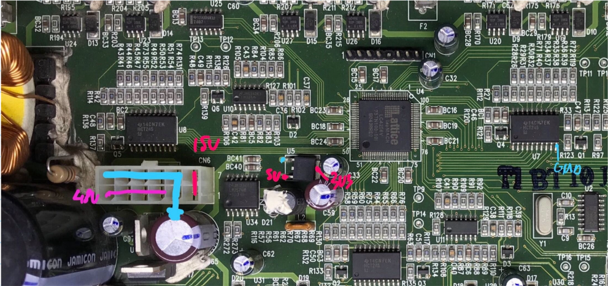
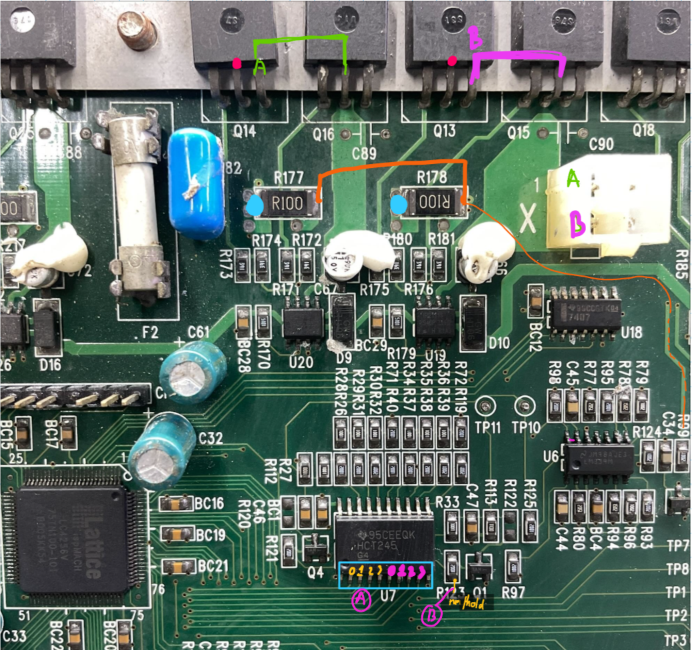
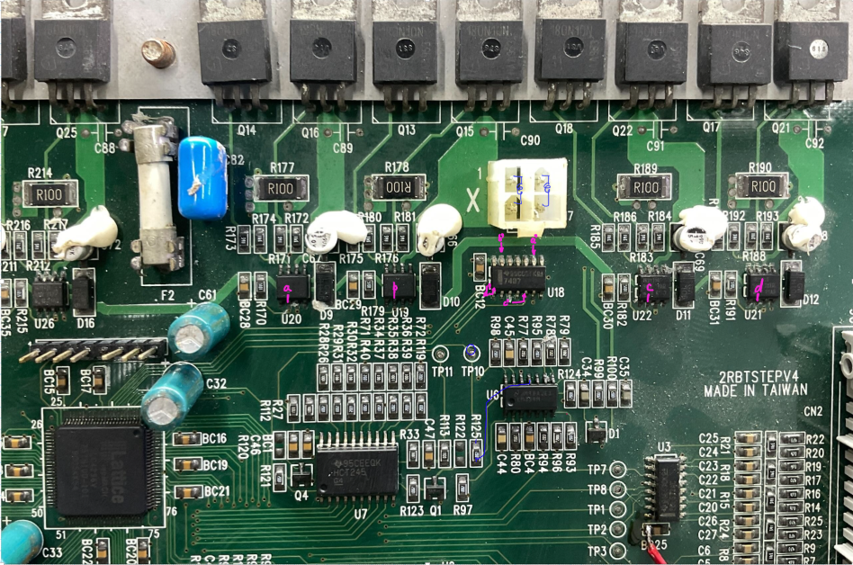
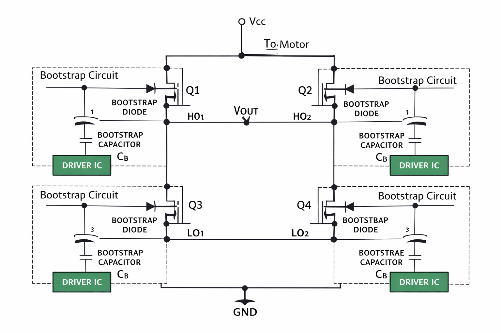
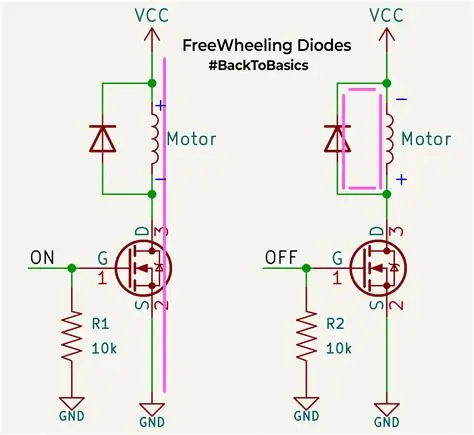

# Hardware Circuit Design and Power Architecture

This document provides a comprehensive technical breakdown of the hardware circuitry, power distribution rails, gate driver stages, current sensing comparators, and inductive protection networks for the **AGM AG32VF303** 1-Axis Stepper Driver board, synthesized from hardware reverse engineering and reference designs (Siruba, Brother 430D).

---

## 1. Multi-Rail Power Distribution System

The driver board operates from three distinct, galvanically shared voltage rails:

```
+-------------------------------------------------------------------------+
|                        POWER RAIL TOPOLOGY                              |
|                                                                         |
|  +------------------------+      +-----------------------------------+  |
|  | MOTOR POWER SUPPLY     |      | GATE DRIVER SUPPLY                |  |
|  | +36V to +48V DC        |      | +15V DC (Red Lead)                |  |
|  | (Purple Lead)          |      | Powers IRS2111S (U19, U20,        |  |
|  | Main H-Bridge Supply   |      |                  U21, U22)        |  |
|  +-----------+------------+      +-----------------+-----------------+  |
|              |                                     |                    |
|              v                                     v                    |
|       [4x N-MOSFETs]                       [Gate Drive ICs]             |
|       [per Coil H-Bridge]                  [High/Low Side Pins]         |
|              |                                     |                    |
|              +------------------+------------------+                    |
|                                 |                                       |
|                                 v                                       |
|                    POWER GROUND / 0V (Blue Lead)                        |
+-------------------------------------------------------------------------+
```

| Rail Name | Color Code | Nominal Voltage | Target Subsystem | Design Considerations |
| :--- | :---: | :---: | :--- | :--- |
| **Motor Rail** | **Purple Lead** | **+36V to +48V** | H-Bridge Power MOSFETs & Motor Coils | High bulk capacitance ($1000\text{ }\mu\text{F} \text{ to } 2200\text{ }\mu\text{F}$ low-ESR) to absorb inductive flyback currents during Fast Decay. |
| **Gate Rail** | **Red Lead** | **+15V** | IRS2111S Gate Driver VCC | Powers internal level shifters and charges bootstrap capacitors to provide $V_{GS} = 15\text{V}$ for hard MOSFET saturation. |
| **Logic Rail** | **Orange Lead** | **+3.3V** | AGM AG32 SoC, U7 Buffer, 7407 Inverters, Comparators | Regulated via onboard LDO/buck from 15V. Decoupled with $100\text{ nF}$ ceramic caps at every IC. |
| **GND** | **Blue Lead** | **0V** | Shared System Common Return | Star ground routing: High-current motor ground separated from sensitive analog comparator ground. |


*Figure 1: Power supply rails routing on the physical driver board (15V Gate rail, 36-48V Motor supply, 0V Common Ground).*

---

## 2. Signal Buffering, R-2R DAC, and Reference Conditioning

To convert 4-bit CPLD digital amplitude codes into clean sinusoidal analog reference voltages ($V_{\text{ref}}$) without noise corruption or loading effects:

```
+---------------+     +---------------+     +---------------+     +----------------+
| AGM AG32 CPLD |     | U7 Buffer IC  |     | 4-bit R-2R    |     | 10k Protection |     +-------------+
| 4-bit Output  |====>| (High-current |====>| Resistor Net  |====>| Resistor       |====>| (+) Input   |
| (3.3V Logic)  |     | CMOS buffer)  |     | (Ladder)      |     | (Filter)       |     | Comparator  |
+---------------+     +---------------+     +---------------+     +----------------+     | IC          |
                                                    |                                    |             |
                                                    v                                    |             |
                                            TP10 (Coil A - Sin)                          |             |
                                            TP11 (Coil B - Cos)                          |             |
                                                                                         |             |
                                   +-----------------------------------------------------+             |
                                   |                                                                   |
                                   |   +-------------------+                                           |
                                   |   | Shunt Resistor    |                                           |
                                   +-->| R_shunt (0.1 ohm) |==========================================>| (-) Input   |
                                       +-------------------+                                           +-------------+
```

### Signal Path Workflow:
1. **Digital Synthesis:** The CPLD outputs 4-bit codes for Coil A (`dac_out_x_a[3:0]`) and Coil B (`dac_out_x_b[3:0]`).
2. **Buffer Stage (U7):** Digital pins drive an intermediate buffer IC (U7) providing fast rise/fall times and low output impedance, eliminating voltage sag on CPLD I/O banks.
3. **Discrete R-2R Ladder:** Converts the 4-bit binary values into step-wise sinusoidal voltages.
4. **Test Points:**
   - **`TP10`:** Analog reference voltage for Phase A (Sine, $0^\circ$).
   - **`TP11`:** Analog reference voltage for Phase B (Cosine, $90^\circ$).
5. **Series Protection:** A $10\text{ k}\Omega$ resistor isolates the ladder from comparator input bias currents and switching transients.
6. **Closed-Loop Comparison:** The comparator compares $V_{\text{ref}}$ against the voltage drop across the current sense shunt ($V_{\text{shunt}} = I_{\text{coil}} \times R_{\text{shunt}}$):
   - **$I_{\text{coil}} < I_{\text{target}}$:** Comparator output is `1` (Active HIGH) $\rightarrow$ CPLD maintains `S_DRIVE` state to ramp up coil current.
   - **$I_{\text{coil}} \ge I_{\text{target}}$:** Comparator output falls to `0` (Active LOW) $\rightarrow$ CPLD exits `S_DRIVE` immediately, entering Mixed Decay.


*Figure 2: Reference voltage DAC ladder routing and test points TP10 (Sine) and TP11 (Cosine).*

---

## 3. Gate Driver Architecture (IRS2111S & 7407 Inverters)

The H-bridge power stage uses 4 discrete IRS2111S half-bridge gate driver ICs (**U19, U20, U21, U22** on board):

```
                        +----------------------+
                        | CPLD Output (a', b') |
                        +----------+-----------+
                                   |
                                   v
                        +----------------------+
                        | 7407 Open-Drain NOT  |
                        | (Inverter / Buffer)  |
                        +----------+-----------+
                                   |
                         Signal a  |  Signal b
                                   v
                     +-------------+-------------+
                     |                           |
                     v                           v
              +--------------+            +--------------+
              | U19 IRS2111S |            | U20 IRS2111S |
              | (Left Leg A) |            | (Right Leg A)|
              +-------+------+            +-------+------+
                      |                           |
                      +-------------+-------------+
                                    |
                                    v
                           [Motor Coil Phase A]
```

- **U19 & U20:** Drive Left and Right legs of Coil A ($a', b' \xrightarrow{\text{7407}} a, b \rightarrow \text{IRS2111S}$).
- **U21 & U22:** Drive Left and Right legs of Coil B ($c', d' \xrightarrow{\text{7407}} c, d \rightarrow \text{IRS2111S}$).
- **Built-in Dead Time:** The IRS2111S features an internal hardware dead time ($650\text{ ns}$ typ.) between its High-side (`HO`) and Low-side (`LO`) gate outputs, preventing cross-conduction shoot-through.
- **Fail-Safe Operation:** When CPLD outputs `q1 = 0` and `q3 = 0`, the driver turns both Low-side MOSFETs ON, establishing a low-impedance ground recirculating path.


*Figure 3: Four IRS2111S gate driver ICs (U19, U20, U21, U22) and 7407 inverter buffer stages on the driver board.*

---

## 4. Bootstrap Circuit Principles (N-Channel MOSFETs)

All four switches in each H-bridge are high-efficiency N-Channel MOSFETs. Driving the high-side N-FET requires its gate voltage to be at least $10\text{V}$ above the motor rail ($V_{\text{motor}} + 15\text{V}$):

```
        +15V Rail
            |
          [Diode D_boot] (Ultrafast)
            |
            +------------+------------+
            |                         |
        [C_boot]                      |
     (100nF - 1uF)                    v
            |                   [IRS2111S VB Pin]
            |                         |
    Switch Node (VS) <----------------+
            |
       Motor Coil
```

### Operational Mechanics:
1. **Recharge Phase (Low-Side ON):** While the low-side FET is conducting, the switch node $V_S$ is pulled to $0\text{V}$ (GND). The bootstrap capacitor $C_{\text{boot}}$ charges from the +15V rail through diode $D_{\text{boot}}$.
2. **High-Side Conduction:** When the high-side FET is turned ON, $V_S$ rises to $V_{\text{motor}}$ ($+36\text{V}$ to $+48\text{V}$). Diode $D_{\text{boot}}$ becomes reverse-biased, isolating the bootstrap capacitor. The capacitor supplies gate charge, elevating the gate to $V_{\text{motor}} + 15\text{V}$.
3. **Critical Operating Rule:** Bootstrap capacitors discharge over time due to quiescent leakage currents. **The high-side switch must never be held ON indefinitely.** Continuous PWM switching (30 kHz master chopper) guarantees regular recharging cycles.


*Figure 4: Bootstrap capacitor and diode circuit powering the high-side N-Channel MOSFET gate.*

---

## 5. Inductive Kickback and Snubber Protection Networks

Stepper motor windings possess significant inductance ($L \approx 1\text{ mH to } 10\text{ mH}$). Switching high currents ($2\text{A to } 4\text{A}$) generates voltage spikes governed by:

$$e = -L \frac{di}{dt}$$

$$W = \frac{1}{2} L I^2$$

To prevent avalanche breakdown and gate oxide puncture:

```
+-------------------------------------------------------------------------+
|                  SNUBBER & PROTECTION TOPOLOGIES                        |
|                                                                         |
|  1. FREEWHEELING DIODES           2. RC SNUBBER                         |
|     Recirculate energy back to       Damps parasitic LC ringing and     |
|     supply rail or ground.           restricts dv/dt.                   |
|     Requires fast t_rr.                                                 |
|                                                                         |
|  3. TVS DIODE CLAMP               4. RCD SNUBBER                        |
|     Clamps spikes in picoseconds     Diode routes spike into capacitor, |
|     at breakdown voltage V_BR.       resistor dissipates energy safely. |
+-------------------------------------------------------------------------+
```

1. **Freewheeling Recirculation:** Fast recovery diodes conduct flyback energy back into the power bus during Slow and Fast decay phases.
2. **RC Snubber:** Connected across each MOSFET ($R \approx 10\text{ }\Omega, C \approx 1\text{ nF}$) to damp parasitic ringing caused by PCB trace inductance.
3. **TVS Diode Protection:** Fast bidirectional TVS diodes (e.g. SMBJ or P6KE series) placed on the DC motor rail clamp overvoltage spikes within $< 1\text{ ps}$.
4. **RCD Snubber:** Used on high-inductance motors to capture transient inductive energy in a capacitor through a diode and bleed it as heat through a power resistor.


*Figure 5: Inductive flyback suppression circuit: freewheeling diode paths and snubber protection.*

---

## 6. Motor Rotational Speed Derivations

For a standard 2-phase hybrid stepper motor with a $1.8^\circ$ step angle:

$$\text{Steps per revolution} = \frac{360^\circ}{1.8^\circ} = 200 \text{ full steps/rev}$$

$$\text{Microsteps per revolution} = 200 \times N \quad (N = 8 \text{ or } 16)$$

$$\text{Speed } n \text{ (rev/s)} = \frac{f_{\text{step\_full}}}{200} = \frac{f_{\text{pulse}}}{200 \times N}$$

$$\text{RPM} = n \times 60 = \frac{f_{\text{pulse}} \times 60}{200 \times N}$$

### Example Calculations:

| Pulse Frequency ($f_{\text{pulse}}$) | Resolution ($N$) | Equivalent Full Steps/s | Shaft Speed (rev/s) | RPM |
| :---: | :---: | :---: | :---: | :---: |
| **800 Hz** | 8 | 100 Hz | 0.50 rev/s | **30 RPM** |
| **1600 Hz** | 16 | 100 Hz | 0.50 rev/s | **30 RPM** |
| **3200 Hz** | 16 | 200 Hz | 1.00 rev/s | **60 RPM** |
| **3700 Hz** | 16 | 231 Hz | 1.15 rev/s | **69.4 RPM** (Pull-in Limit) |
