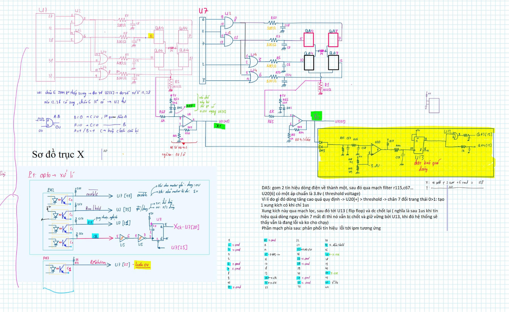
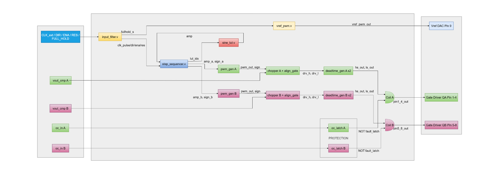
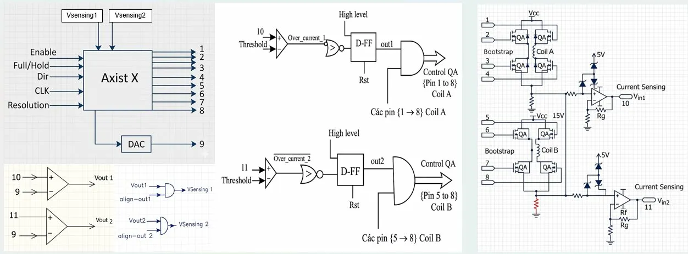

# Industrial Stepper Driver Benchmark and Reverse-Engineering Analysis

This document provides a comparative architectural study evaluating the **AGM AG32** implementation against proven commercial industrial stepper drivers analyzed during project research: the **Siruba CPLD Stepper Driver** and the **Brother 430D Industrial Sewing Machine Axis-X Driver** (documented in Sheet `Checklist` rows 20–30 of `Step-AGM.xlsx`).

---

## 1. Commercial Reference Architectures

### 1.1 Siruba Industrial CPLD Stepper Driver
Industrial sewing and embroidery machines from Siruba employ dedicated CPLD devices (e.g., Altera MAX II / EPM series) to drive high-torque bipolar stepper motors:
- **Architecture:** Discrete CPLD paired with an external microcontroller host over a parallel control bus.
- **Reference Voltage Generation:** 4-bit to 6-bit discrete resistor ladders buffered through high-speed CMOS line drivers.
- **Current Regulation:** Peak-current chopping utilizing analog comparators with hardware-fixed Mixed Decay intervals.
- **Limitations:** Timing parameters (dead time, decay ratios, chopper frequency) are hardwired into CPLD logic or set via passive RC components, requiring hardware redesign or FPGA resynthesis to retune for different motor models.

*Figure 1: Reverse-engineered schematic analysis of the Siruba CPLD stepper driver and Brother 430D axis board.*

---

### 1.2 Brother 430D Sewing Machine Axis-X Driver
The Brother BAS-430D computerized lockstitch bartacking machine features an industry-standard motion control interface:
- **5-Wire Command Interface:**
  1. `ENABLE`: Master power stage activation.
  2. `RUN / HOLD`: Dynamic current scaling (100% Run current / 50% resting Hold current).
  3. `DIR`: Clockwise / Counter-Clockwise directional steering.
  4. `PULSE` (`CLK`): Microstep increment trigger.
  5. `RESOLUTION`: Microstep resolution toggle (8-step vs 16-step mode).
- **Power Stage:** Intelligent Power Module (IPM) or discrete H-bridges with low-side shunt current measurement and op-amp differential conditioning.
- **Overcurrent Protection:** Dedicated analog comparator circuit monitoring total DC return current, tripping a latch that cuts off gate drive pulses instantly to prevent IPM destruction.

*Figure 2: Brother 430D CPU-to-IPM drive interface and differential shunt amplifier stage.*

*Figure 3: Dedicated industrial overcurrent sensing circuit and latch comparator topology.*

---

## 2. Comparative Feature Matrix

| Architectural Feature | Siruba CPLD Driver | Brother 430D Axis-X | AGM AG32 Implementation |
| :--- | :---: | :---: | :---: |
| **Control Core** | Discrete CPLD | Dedicated MCU + IPM | **AGM AG32VF303 SoC (RISC-V + FPGA)** |
| **Logic Integration** | External IC | External Board Module | **Single-Chip SoC (~2K LUTs Fabric)** |
| **CPU-to-Logic Latency** | Parallel Bus ($> 100\text{ ns}$) | Wire harness / Optos | **Internal 32-bit AHB-Lite ($10\text{ ns}$)** |
| **Chopper Parameter Tuning** | Fixed / Passive RC | Fixed Factory Calibrated | **Fully Programmable in C via AHB** |
| **Microstepping Modes** | 8-step / 16-step | 8-step / 16-step | **8-step / 16-step + Dynamic Switching** |
| **Current Scaling** | External Hardware Mux | Hardware Pin (Run/Hold) | **Hardware Pin + 50% Right-Shift DAC** |
| **Dead-Time Generation** | RC / Gate Driver | IPM Internal | **IRS2111S Internal + Programmable RTL Margin** |
| **Overcurrent Reaction Time** | Hardware Latch ($< 1\text{ }\mu\text{s}$) | Op-amp Comparator | **Digital Blanking ($80\text{ ns}$) + Hardware Latch** |
| **Zero-Crossing Management** | Passive Decay | Decay Blending | **Non-Zero Offset LUT ($dac_{\text{min}} = 2$)** |

---

## 3. Key Architectural Innovations in the AG32 Driver

1. **Single-Chip SoC Consolidation:**
   - Eliminates the costly and noisy external wiring between microcontroller and CPLD present in Siruba and Brother systems.
   - The RISC-V CPU and FPGA share a 100 MHz system clock and direct memory bus.
2. **Dynamic Firmware Reconfigurability:**
   - In traditional industrial boards, adapting the driver for higher inductance motors required replacing timing capacitors. On the AG32, `dead_cycles`, `fast_cycles`, `slow_cycles`, and `period_cycles` are adjusted on-the-fly via firmware function calls (`stepper_set_timing()`).
3. **Optimized Mixed-Decay FSM:**
   - Simplifies legacy 8-to-10 state zero-crossing FSMs down to 6 deterministic states by using a biased LUT ($dac_{\text{min}} = 2$).
4. **Enhanced Noise Immunity:**
   - A digital 8-clock blanking filter ($80\text{ ns}$ @ 100 MHz) completely eliminates false overcurrent trips caused by MOSFET reverse-recovery currents, exceeding the reliability of legacy analog RC filters.
