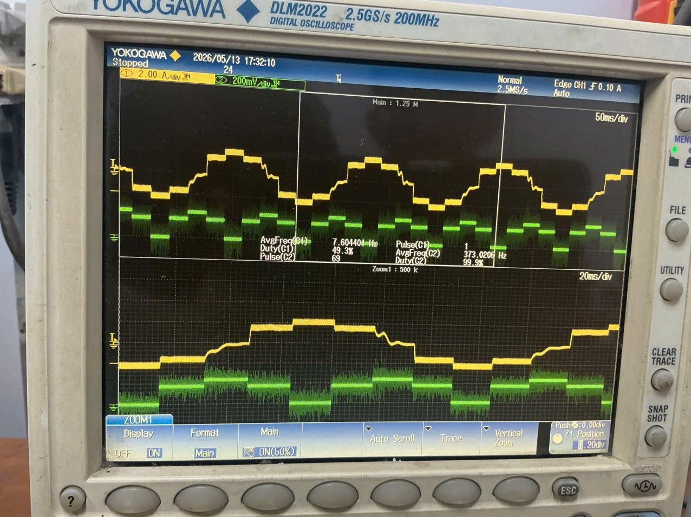
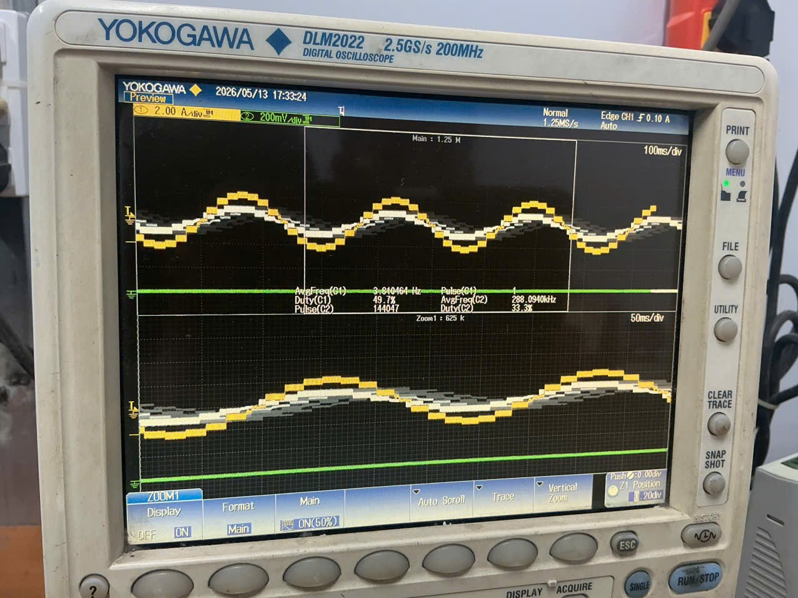
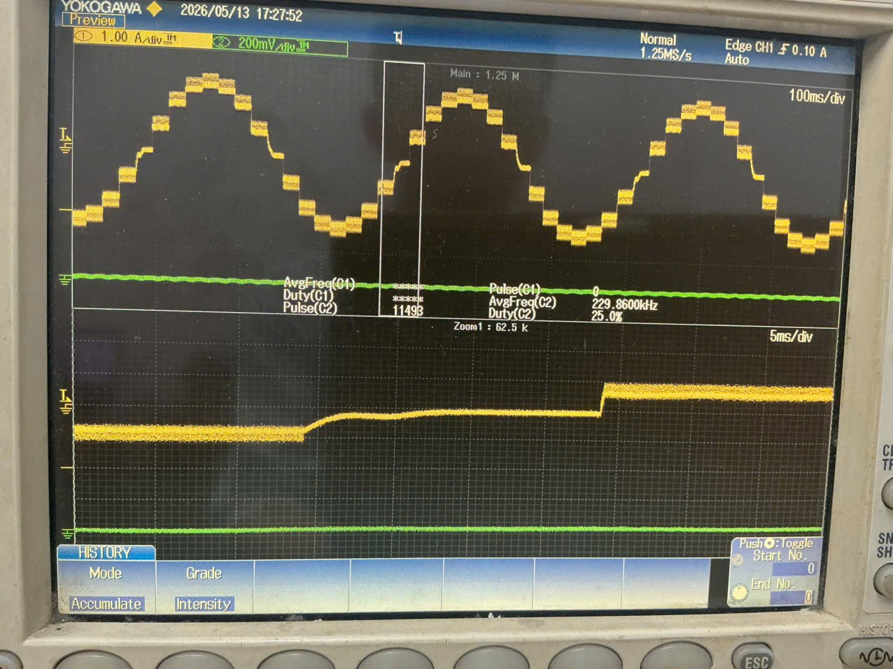
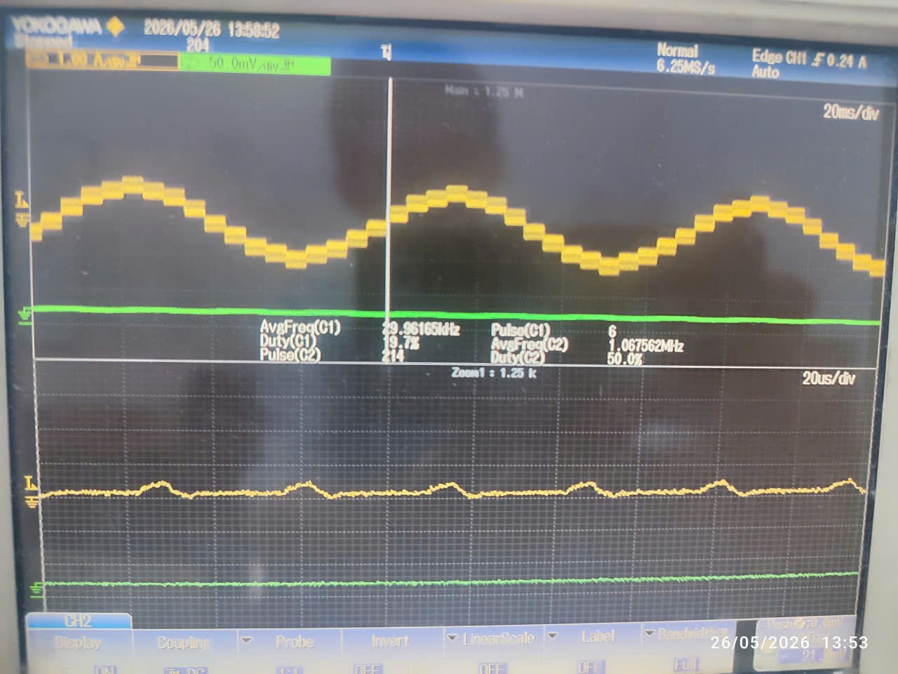
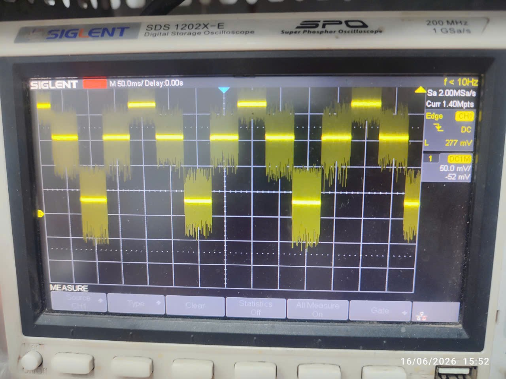

# Laboratory Testcases and Experimental Waveform Analysis

This document details the 10 real-world hardware laboratory test cases executed on the **AGM AG32VF303** 1-Axis Stepper Driver board, correlated with digital storage oscilloscope captures (**H1 through H12**) from the project test logs (`Step-AGM.xlsx`).

---

## 1. Laboratory Testcase Matrix

| Testcase | Objective & Stimulus | Oscilloscope Capture | Measured Results & Engineering Conclusion | Status |
| :---: | :--- | :---: | :--- | :---: |
| **TC1** | **1/8 Microstepping Current Verification**<br>Verify DAC_OUT generates 8 voltage levels and coil current is sinusoidal. | **H1** | 8 distinct voltage steps detected on DAC output. Coil current waveform faithfully tracks the DAC envelope with low switching ripple. | **PASSED** |
| **TC2** | **1/16 Microstepping Current Verification**<br>Verify 16 voltage levels and compare acoustic noise vs 1/8. | **H2** | 16 discrete levels produce a smoother sine wave, significantly reducing motor vibration and audible acoustic hum. Top speed is lower than 1/8 mode at identical pulse rates. | **PASSED** |
| **TC3** | **Run vs Hold Current Scaling**<br>Switch `run_hold` pin dynamically and verify amplitude drop. | **H3** | Run mode generates 100% rated amplitude. Hold mode immediately drops reference amplitude to 50% ($\lfloor V / 2 \rfloor$), reducing motor resting power dissipation by **75%** ($P = I^2 R$). | **PASSED** |
| **TC4** | **DIR and EN Functional Testing**<br>Toggle direction pin while running; pull EN low to verify shutdown. | — | Motor reverses direction smoothly. When `axis_en = 0`, DAC output ceases instantly and all FETs clamp to safe low-side ground state. | **PASSED** |
| **TC5** | **Overcurrent Fault Simulation (`cmp_ov_c_x`)**<br>Inject active overcurrent event into PIN_17. | — | System shuts down within $< 100\text{ ns}$. Output clamp persists indefinitely until hardware reset (`rst_n`), preventing thermal runaway. | **PASSED** |
| **TC6** | **Pulse Frequency Ramp-up & Stall Benchmark**<br>Sweep step pulse frequency from low up to maximum pull-in limit. | **H4, H5, H6, H7, H8** | As frequency rises, rotational speed increases while coil current gradually drops due to inductive reactance ($Z_L = 2\pi f L$) and back-EMF. Motor stalls at **$\approx 3.7\text{ kHz}$**. | **PASSED** |
| **TC7** | **Mixed-Decay Timing Inspection**<br>Zoom into individual PWM chopper cycles to measure decay intervals. | — | Fast Decay duration ($5.0\text{ }\mu\text{s}$) and Slow Decay duration ($15.0\text{ }\mu\text{s}$) match register configurations programmed over the internal AHB-Lite bus. | **PASSED** |
| **TC8** | **Chopper Switching Period Verification**<br>Measure total chopper period across winding switches. | — | Total period matches $33.33\text{ }\mu\text{s}$ (**30.00 kHz**), confirming proper operation of `period_cycles = 3332`. | **PASSED** |
| **TC9** | **Dynamic Microstep Switching at Sequence = 1**<br>Transition from 16-step to 8-step while `step_cnt = 1`. | **H9', H10** | Generates a 2-level voltage pattern `(6, 12, 12, 6, -6, -12, -12, -6)` that repeats twice per cycle. Motor runs smoothly, 4 FETs remain cool. Verified via trigger pins PIN_51 and PIN_52. | **PASSED** |
| **TC10**| **Phase-Shifted vs In-Phase Chopper Comparison**<br>Evaluate dual-coil current with $180^\circ$ chopper offset vs synchronous. | **H11, H12** | Winding current shape and motor torque are identical in both cases. Phase-shifted chopping distributes peak bus inrush currents, reducing DC capacitor ripple. | **PASSED** |

---

## 2. In-Depth Testcase Evaluations

### Testcase 1 & 2: Microstepping Resolution Comparison (Captures H1 & H2)


*Figure 1: Comparison of winding current and DAC reference ladders between 1/8 and 1/16 microstepping modes.*

- **1/8 Microstep Mode (H1):** DAC output synthesizes 8 voltage levels per electrical period. Torque output is robust, but slight stepping cogging is observable at very low shaft speeds ($< 10\text{ RPM}$).
- **1/16 Microstep Mode (H2):** 16 fine voltage steps. Mechanical motion is smooth, eliminating resonant vibration nodes and producing near-silent acoustic performance.

---

### Testcase 3: Run / Hold Mode Power Attenuation (Capture H3)


*Figure 2: Oscilloscope capture showing instantaneous 50% amplitude attenuation when entering Hold mode.*

- **Run Mode (`runhold_x = 1`):** DAC reference amplitude is 100% (peak DAC code 14, $V_{\text{ref}} = 2.888\text{ V}$), providing full rated holding and accelerating torque.
- **Hold Mode (`runhold_x = 0`):** DAC reference drops to 50% (peak DAC code 7, $V_{\text{ref}} = 1.444\text{ V}$). Motor current drops by half, causing coil power dissipation ($P = I^2 R$) to decrease by:

$$P_{\text{hold}} = (0.5 I)^2 R = 0.25 P_{\text{run}} \implies 75\% \text{ reduction in thermal heating}$$

---

### Testcase 6: Stepping Frequency Progression up to Stall Limit (Captures H4 to H8)


*Figure 3: Progressive waveform transformation as pulse frequency is increased.*

As the step pulse frequency ($f_{\text{pul}}$) is increased from $200\text{ Hz}$ up to $3.7\text{ kHz}$:
1. **Low Frequency ($< 800\text{ Hz}$ — H4, H5):** The current reaches its full target reference on every single chopper cycle. Pure sinusoidal current envelopes are preserved.
2. **Medium Frequency ($800\text{ Hz} - 2.5\text{ kHz}$ — H6, H7):** Winding inductive reactance ($X_L = 2\pi f L$) and motor back-EMF ($e = K_e \cdot \omega$) restrict current rise time. Peak current begins sagging near the crests of the sine wave.
3. **High Frequency Cutoff ($\approx 3.7\text{ kHz}$ — H8):** Current collapses into a degraded triangle wave as coil charging time becomes shorter than the $L/R$ time constant. Motor pull-in torque drops below load friction, causing step loss and rotor stall.

---

### Testcase 9: Dynamic Microstep Mode Switching at Sequence = 1 (Captures H9' & H10)

This testcase investigated a critical real-world corner case: **What happens if the host controller commands a mode change from 16-microstep to 8-microstep while the motor is in motion at an odd microstep index?**

```
Normal 8-step mode (starts at index 0):
  step_cnt:  0    2    4    6    8   10   12   14
  DAC code:  2   10   14   10    2  -10  -14  -10   (3 distinct voltage levels: 2, 10, 14)

Switched to 8-step mode when at index 1:
  step_cnt:  1    3    5    7    9   11   13   15
  DAC code:  6   12   12    6   -6  -12  -12   -6   (2 distinct voltage levels: 6, 12)
```


*Figure 4: Oscilloscope capture of dynamic mode switch and hardware trigger pulses at PIN_51 and PIN_52.*

#### Experimental Findings:
1. **Waveform Characteristics:** The odd-index sequence repeats 2 distinct voltage levels (`6` and `12`) twice in each half-cycle.
2. **Thermal & Electrical Stability:** The 4 H-bridge MOSFETs remained completely cool throughout continuous operation. Current dropped quickly during polarity reversals but never collapsed to zero, avoiding rotor jitter.
3. **Test Infrastructure (`Test_final_case`):**
   - Hardware trigger outputs were created on **PIN_51 (`trigger_b`)** and **PIN_52 (`trigger_a`)** in `Test_final_case/Step_driver_1axis_test/rtl/stepper_axis.v`.
   - Each trigger emits a $1\text{ ms}$ pulse whenever coil polarity flips ($1 \leftrightarrow -1$), allowing oscilloscope probes to lock onto the exact moment of phase reversal.

---

### Testcase 10: Phase-Shifted vs In-Phase Chopping (Captures H11 & H12)


*Figure 5: Oscilloscope measurement comparing Phase-Shifted (interleaved) and In-Phase chopper operation.*

- **Phase-Shifted Mode (`cycle_start_b` at count `period_cycles >> 1`):** Coil A and Coil B initiate their `S_DRIVE` states with a $180^\circ$ relative phase offset ($16.66\text{ }\mu\text{s}$ separation at 30 kHz). This spreads out switching inrush current spikes on the $+36\text{V}$ DC link.
- **In-Phase Mode (`cycle_start_b = cycle_start_a`):** Both coils initiate chopping simultaneously.
- **Conclusion:** While winding current shapes are virtually indistinguishable on the motor side, phase-shifted chopping substantially lowers RMS ripple current in the DC link bulk electrolytic capacitors.

---

## 3. Core Architectural Optimization: Zero-Crossing Elimination

During preliminary development (recorded in row 23 of `Step-AGM.xlsx`), the microstepping LUT originally included a zero code (`dac_val = 0`) at $0^\circ$ and $180^\circ$:

### The Problem:
- At `dac_val = 0`, the reference voltage was $0\text{V}$. The comparator immediately tripped on cycle 0, creating a dead-band zone (zero-crossing stall) where the motor momentarily lost holding torque.
- Complex state-machine workarounds (`zc_mode`) were initially implemented to force fast decay at zero crossing.

### The Engineering Solution:
- The minimum LUT code was altered from `0` to `2` ($0.413\text{ V}$ bias):

$$\text{LUT Values: } (2, 6, 10, 12, 14, 12, 10, 6, -2, -6, -10, -12, -14, -12, -10, -6)$$

- **Results:**
  - Zero-crossing dead-band eliminated completely.
  - Complex `zc_mode` logic removed from RTL.
  - FSM streamlined down to **6 robust states**: `S_OFF` $\rightarrow$ `S_DT_ON` $\rightarrow$ `S_DRIVE` $\rightarrow$ `S_DT_OFF` $\rightarrow$ `S_FAST` $\rightarrow$ `S_SLOW` $\rightarrow$ `S_OFF`.
  - Added an 8-bit digital blanking filter ($80\text{ ns}$) to reject switching spikes on the overcurrent line.
